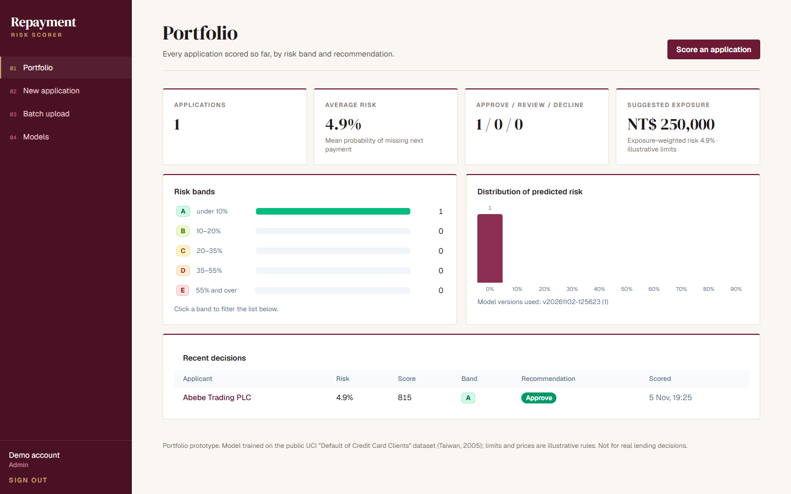
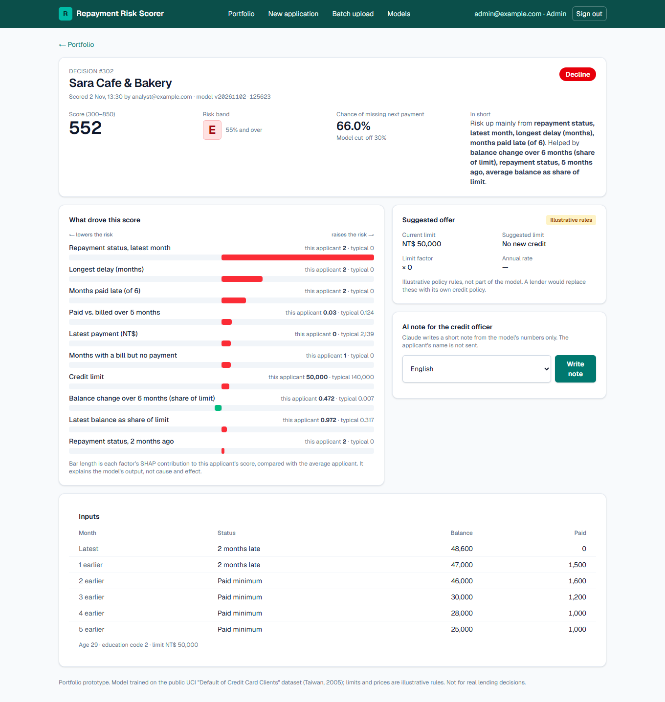
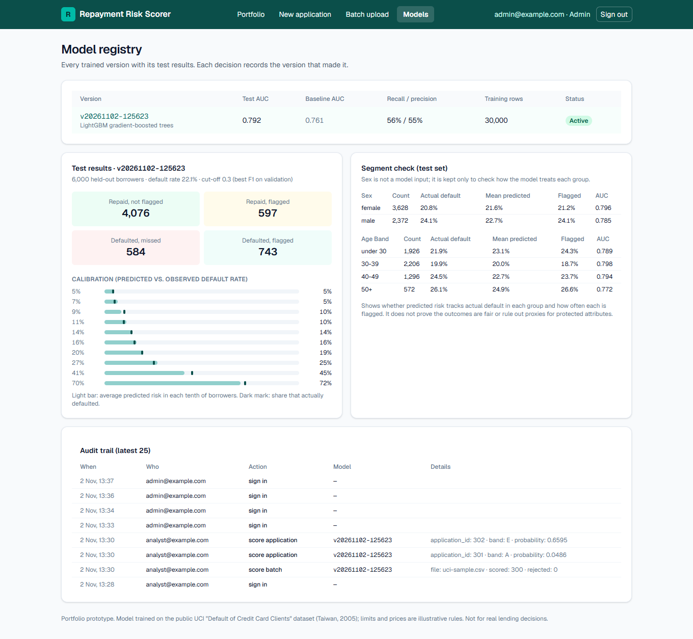
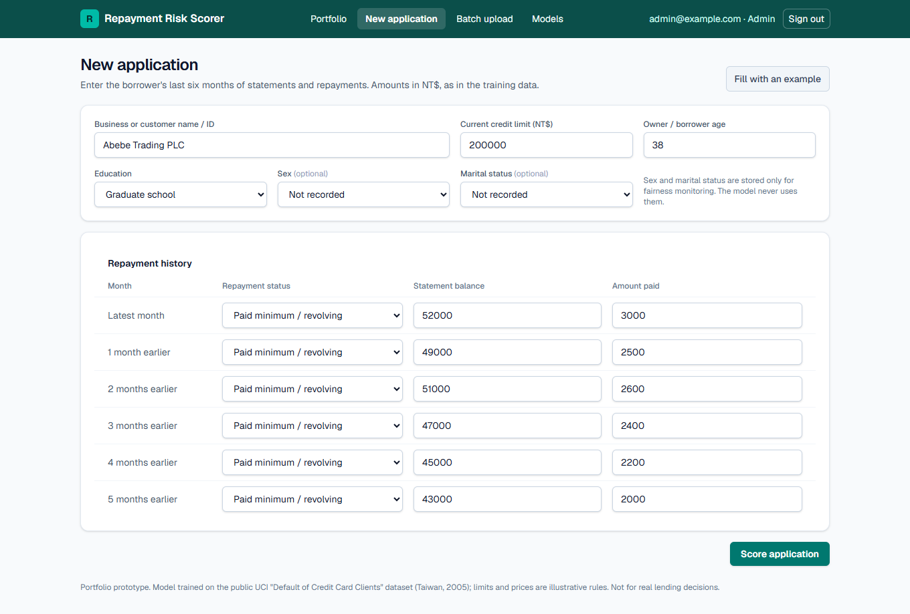

# Repayment Risk Scorer: explainable credit decisions

A full-stack credit-risk tool for a lender's credit team. An analyst enters a borrower's last six months of statements and repayments (or uploads a CSV of thousands), and the app returns the **probability of missing the next payment**, a 300–850 score, a risk band, a recommendation, and **the factors behind that score**. Every decision is stored with the model version that made it, and an admin chooses which trained model is live.

It is built with a **Next.js** frontend, a **FastAPI** scoring service, a **LightGBM** model with **SHAP** explanations, and **PostgreSQL** (SQLite for quick local runs). Claude can optionally write a short decision note in **English or Amharic**.

<p>
  
  
</p>

> **What the data is.** The model is trained on the public UCI *Default of Credit Card Clients* dataset: 30,000 real credit-card accounts in Taiwan from 2005. It is **consumer** credit, not small-business loans or invoices. The U.S. SBA small-business loan files were the first choice, but their portal blocks downloads from this machine, and there is no public dataset of invoice repayments. The app is named for what the data really is. [How the same pipeline applies to SME and invoice lending](#using-it-for-sme-or-invoice-lending) is explained below.

---

## Quick start

```bash
# 1. Python API
python -m venv .venv && . .venv/bin/activate      # Windows: .venv\Scripts\activate
pip install -r requirements-dev.txt
cp .env.example .env                              # set SECRET_KEY and the two accounts
uvicorn api.main:app --port 8000                  # docs at http://localhost:8000/docs

# 2. Frontend (second terminal)
cd frontend
npm install
API_URL=http://localhost:8000 npm run dev         # http://localhost:3000
```

A trained model is included in `models/`, so the app works straight away. To retrain on the full data:

```bash
python scripts/download_data.py    # UCI data into data/raw/ (git-ignored)
python -m ml.train                 # writes models/<new version>/; the API registers it on start
```

### With Docker (PostgreSQL)

```bash
cp .env.example .env               # fill in SECRET_KEY and the accounts
docker compose up --build          # http://localhost:3000, API on :8000
```

Compose runs three Linux containers: PostgreSQL 17, the API (Python 3.13 slim) and the frontend (Node 24 slim).

---

## Accounts

| Role | Can |
|---|---|
| **Analyst** | Score applications, upload CSV batches, read decisions and the portfolio, ask for AI notes, see the model registry |
| **Admin** | Everything an analyst can, plus **switch the active model** and read the **audit trail** |

Both accounts are created when the API starts, from `ADMIN_EMAIL` / `ADMIN_PASSWORD` and `ANALYST_EMAIL` / `ANALYST_PASSWORD` in `.env`. Passwords are stored as scrypt hashes. Sessions are signed, HTTP-only cookies.

With `DEMO_ACCOUNT=true` the sign-in page also shows **Try the demo**. It opens a shared account that has no password and sees the admin pages, but is walled off: it sees only the applications it scored itself and only its own audit entries, and it cannot switch the live model.

---

## What it does

**Score one application.** You enter the credit limit, age, education and six months of repayment status, statement balance and amount paid. The decision page shows:
- **Probability of missing the next payment**, plus a **score** (600 at even odds, +50 points each time the odds of repaying double) and a **band** A–E
- A **recommendation**: A–B approve, C review, D–E decline
- **What drove the score**: SHAP contributions for the top factors, each shown next to the typical value
- A **suggested limit and rate**, clearly labelled as **illustrative rules**. They are not part of the model; a lender would plug in its own policy.
- An optional **AI note for the credit officer** (see below)

**Batch upload.** You upload a CSV of up to 5,000 rows (download the template from the page). Valid rows are scored in one pass. Invalid rows come back with the line number and the reason.

**Portfolio.** It shows totals, average risk, approve/review/decline counts, the suggested exposure, a distribution of predicted risk, and a list you can filter by band.

**Model registry.** Every trained version is listed with its test AUC, its baseline AUC, recall and precision, a confusion matrix, a calibration chart and the segment check. An admin can make any version active. From then on, new decisions use that version, and each decision keeps the version that made it.

**Audit trail.** The log records sign-ins, every scoring (single or batch), every AI note and every model switch, with who did it and which model version was involved.

<p>
  
  
</p>

---

## The model

| | LightGBM (live) | Logistic regression (baseline) |
|---|---|---|
| **Test AUC** | **0.792** | 0.761 |
| Brier score | 0.131 | 0.139 |
| Recall at cut-off | 56.0% | 55.7% |
| Precision at cut-off | 55.5% | 52.2% |

- **Data split:** 30,000 borrowers, 22.1% of whom missed the next payment. Split 60/20/20 into train, validation and test, stratified. The data has no application dates, so the split can't be time-based.
- **Training:** gradient-boosted trees (221 trees, early stopping on validation AUC).
- **Cut-off:** 0.30, chosen for the best F1 score on validation.
- **Test confusion matrix (6,000 borrowers):** 4,076 repaid and were not flagged, 597 repaid but were flagged, 584 defaulted and were missed, 743 defaulted and were flagged.
- **Calibration:** checked by deciles on the test set and shown in the app.

**Features** (`ml/features.py`) are built the same way for training and scoring:
- credit limit, age and education
- repayment status for each of the six months
- latest and average balance as a share of the limit
- months paid late and the longest delay
- **amount paid compared with amount billed** (each payment is matched to the previous month's bill)
- months with a bill but no payment
- the balance trend and the latest payment

**Sex and marital status are never model inputs.** They are kept only so the segment check can be run. The test `test_protected_fields_do_not_change_the_score` confirms that changing them doesn't change the score.

**Segment check (test set):**

| Group | Actual default | Mean predicted | Flagged | AUC |
|---|---|---|---|---|
| Female | 20.8% | 21.6% | 21.2% | 0.796 |
| Male | 24.1% | 22.6% | 24.1% | 0.785 |
| Under 30 | 21.9% | 23.1% | 24.4% | 0.789 |
| 30–39 | 19.9% | 20.0% | 18.7% | 0.798 |
| 40–49 | 24.5% | 22.7% | 23.7% | 0.795 |
| 50+ | 26.1% | 24.9% | 26.6% | 0.772 |

The check shows that predicted risk follows actual default in each group, and how often each group would be flagged. It does **not** prove the outcomes are fair. Age is a model input, so it is not neutral by design. The check also can't rule out other features acting as proxies.

Each trained version gets a **model card** (`models/<version>/model_card.md`) covering the data, the metrics, the segments and the limits.

### Explanations

Each score is explained with **SHAP values**, computed by LightGBM's built-in TreeSHAP (`pred_contrib=True`). They are exact for tree models and add up to the model's output; a test checks this. A bar to the right means that factor pushed this applicant's risk **up** compared with the average applicant. A bar to the left means it pushed the risk down. These values explain what the model did. They don't show cause and effect.

### AI notes (optional)

When `ANTHROPIC_API_KEY` is set, the **Write note** button sends Claude (`claude-opus-5-5`) **only** what the model produced:
- probability, score, band and recommendation
- the top factors, each with its value and the typical value
- the illustrative offer

The applicant's name and inputs are not sent. Claude is told not to add or recalculate numbers, and not to change the recommendation. The note can be in English or Amharic. If the model declines a request, the API retries on Anthropic's recommended fallback model. Without a key, the rest of the app works and the decision page shows a **concept preview**: the note's layout filled in from a fixed template with that decision's numbers, clearly labelled as not written by AI.

---

## Using it for SME or invoice lending

The parts that change for SME or invoice data are the **data loader** and the **feature builder**. The API, the registry, the explanations, the audit trail and the UI stay the same.

| This prototype (cards) | SME / invoice financing |
|---|---|
| Monthly statement balance | Invoice amounts issued and financed |
| Amount paid each month | Buyer payments received, days to pay |
| Months late, longest delay | Days past due per invoice, share paid late |
| Balance as share of limit | Financed amount as share of the facility |
| (none) | Buyer concentration and buyer risk, sector, seasonality |
| (none) | Mobile-money and transaction history (behaviour-based lending) |

With a lender's real repayment records, the split should also become **time-based** (train on older loans, test on newer ones), and the illustrative policy rules in `api/policy.py` would be replaced by the lender's own credit policy.

---

## Architecture

```
frontend/ (Next.js 16, React 19, Tailwind 4)
   proxy.js        forwards /api/* to the API at request time; sends signed-out visitors to /login
   app/(app)/      portfolio, new application, decision, batch upload, model registry
api/ (FastAPI)
   main.py         endpoints, sign-in, roles, batch upload, registry, audit trail
   scoring.py      loads a model version, scores rows, SHAP contributions, score and band
   policy.py       illustrative limit and pricing rules
   ai.py           Claude decision notes
   db.py           SQLAlchemy models: users, model_versions, applications, decisions, audit_events
ml/
   features.py     loading, cleaning, feature engineering (shared by training and scoring)
   train.py        split, baseline, LightGBM, threshold, metrics, segment check, model card
models/<version>/  model.joblib, metrics.json, model_card.md
```

The API documents itself at `/docs` (OpenAPI).

| Method | Endpoint | Who |
|---|---|---|
| POST | `/api/auth/login`, `/api/auth/logout` · GET `/api/auth/me` | anyone / signed in |
| POST | `/api/applications` | analyst, admin |
| POST | `/api/applications/batch` (CSV upload) | analyst, admin |
| GET | `/api/applications`, `/api/applications/{id}` | analyst, admin |
| POST | `/api/applications/{id}/summary` | analyst, admin |
| GET | `/api/portfolio`, `/api/models`, `/api/models/{version}` | analyst, admin |
| POST | `/api/models/{version}/activate` | admin |
| GET | `/api/audit` | admin |
| GET | `/api/health`, `/api/batch-template` | anyone |

---

## Tests

```bash
pytest                                  # 31 tests: features, scoring, API, roles, registry, AI (faked)
cd frontend && npm run lint && npm run build
npm run test:e2e                        # Playwright: starts its own API and frontend, desktop + phone
```

- The Python tests **train small models on a committed 2,000-row real sample** (`tests/fixtures/sample.csv`), so they need no download and no secrets.
- Other things they cover:
  - the SHAP values add up to the prediction
  - sex and marital status don't change the score
  - analysts can't switch models
  - every decision records its model version
  - the borrower's name is never sent to the AI
  - the AI declining a request is reported cleanly
- **GitHub Actions** (`.github/workflows/ci.yml`) runs three jobs: the Python tests; lint, build and the Playwright tests for the frontend; and a `docker compose build` on Linux.

---

## Settings (`.env`)

| Variable | Purpose |
|---|---|
| `SECRET_KEY` | Signs sessions. Required, or sessions end when the API restarts |
| `ADMIN_EMAIL`, `ADMIN_PASSWORD`, `ANALYST_EMAIL`, `ANALYST_PASSWORD` | Accounts created on start-up |
| `DATABASE_URL` | Optional. SQLite by default, PostgreSQL in Docker (`postgresql+psycopg://…`) |
| `ANTHROPIC_API_KEY` | Optional. AI decision notes |
| `COOKIE_SECURE` | `true` when served over HTTPS |
| `DEMO_ACCOUNT` | `true` adds the walled-off **Try the demo** account |
| `API_URL` (frontend) | Where the API is, e.g. `http://localhost:8000` |

`.env` is git-ignored and never committed.

---

## Deploy (free tiers)

| Part | Host | Notes |
|---|---|---|
| Database | **Neon** (PostgreSQL) | Free with no expiry; copy the connection string |
| Scoring API | **Render** (Docker, from `render.yaml`) | Free plan sleeps after 15 minutes idle |
| Web app | **Vercel** (Next.js) | Root directory `frontend` |

1. **Neon:** create a project (region near the API, e.g. Frankfurt) and copy the connection string from *Connect*. The app accepts it as shown (`postgresql://…?sslmode=require`); tables are created on first start.
2. **Render:** *New → Blueprint*, pick this repository. Render reads `render.yaml`, generates `SECRET_KEY`, sets `COOKIE_SECURE` and `DEMO_ACCOUNT`, and asks for `DATABASE_URL`, `ADMIN_EMAIL`, `ADMIN_PASSWORD` and the optional `ANTHROPIC_API_KEY`. The trained model in `models/` is part of the image. When it is live, open `https://<service>.onrender.com/api/health`.
3. **Vercel:** *Add New → Project*, import this repository, set **Root Directory** to `frontend`, and add `API_URL` = the Render address (no trailing slash). The browser only talks to Vercel; `proxy.js` forwards `/api/*` to the API, so the session cookie stays on the site's own domain.
4. **Keep the API awake (optional):** add the GitHub Actions variable `API_HEALTH_URL` = `https://<service>.onrender.com/api/health`.

---

## Limitations

- **Old, foreign, consumer data:** 2005 Taiwanese credit cards, not Ethiopian SMEs. Patterns, amounts (NT$) and default rates will differ.
- **No time-based validation**, because the dataset has no dates.
- **Age is a model input.** It is predictive here, but many lenders would remove it or need to justify it.
- **The limit and price rules are invented** for the demo and labelled as such everywhere.
- **SHAP explains the model, not the borrower's situation.** It is not a substitute for a credit officer's judgement.
- **Docker images are built in CI** but were not run on the development machine, which has no Docker. The local runs used SQLite. The PostgreSQL path uses the same SQLAlchemy models and was not run locally.
- **AI notes were tested with a fake client.** No API key was available during development, so a live call has not been made.
- This is a portfolio prototype and is not meant for real lending decisions.

## Data licence

UCI Machine Learning Repository, *Default of Credit Card Clients* (I-Cheng Yeh, 2009), [doi:10.24432/C55S3H](https://doi.org/10.24432/C55S3H), licensed CC BY 4.0. `tests/fixtures/sample.csv` is a 2,000-row extract of it, renamed to this project's column names.
